# Manual de Implantación de Odoo 19

## 1. Gestión de Bases de Datos

Para la práctica se han creado dos bases de datos independientes en el gestor de Odoo (`/web/database/manager`):

* **`demo`**: Creada con datos de demostración activados para realizar las pruebas comerciales.
* **`real`**: Creada totalmente vacía para simular un entorno de producción real.

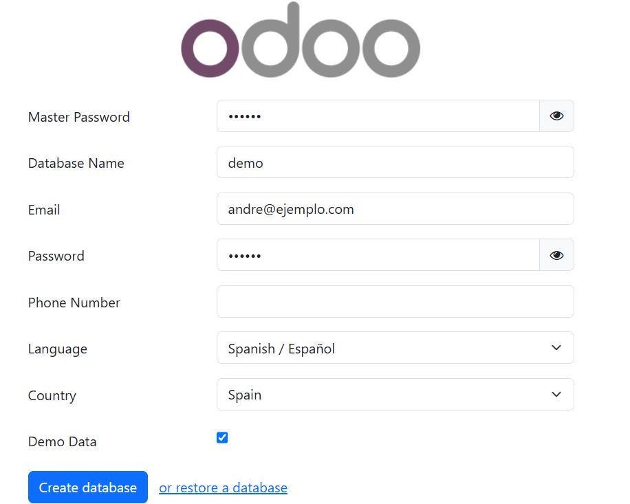

---

## 2. Ejercicio 1 · Tipos de Producto

En Odoo los tipos principales de producto se clasifican en **Bienes**, **Servicio** y **Combinación**. La diferencia entre un bien almacenable y un consumible viene dada por la casilla *Rastrear inventario* (disponible al tener instalada la aplicación de Inventario).

### Resumen de Fichas Identificadas

| Tipo de Producto | Ejemplo Localizado | Rastrear Inventario | Impuestos de Ventas |
| :--- | :--- | :--- | :--- |
| **Bien (con inventario)** | *Silla de oficina* | Activado (Sí) | IVA 21% |
| **Bien (sin inventario)** | *Folios / Tornillos* | Desactivado (No) | IVA 21% |
| **Servicio** | *Horas de asistencia* | N/A | IVA 21% |
| **Combinación** | *Pack de bienvenida* | Según componentes | IVA 21% |
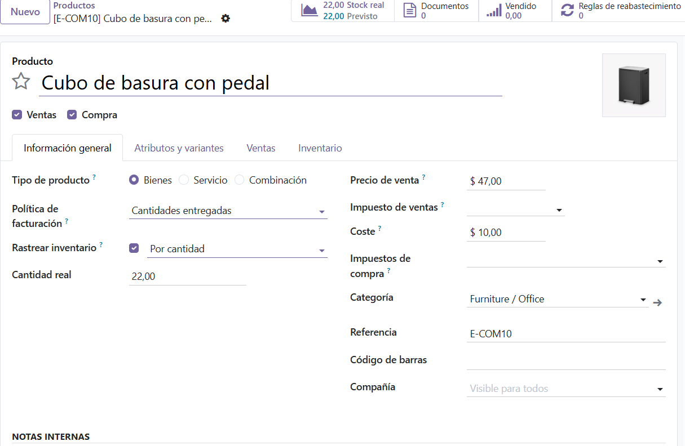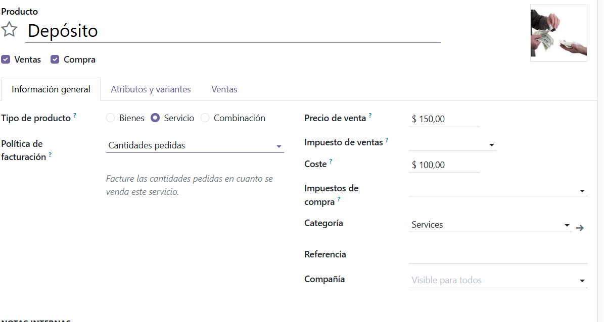
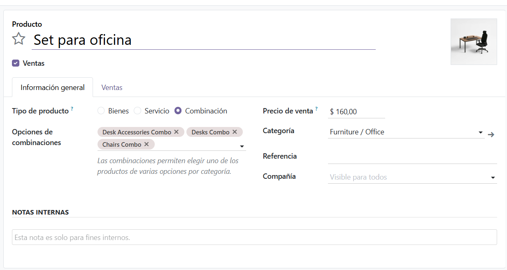
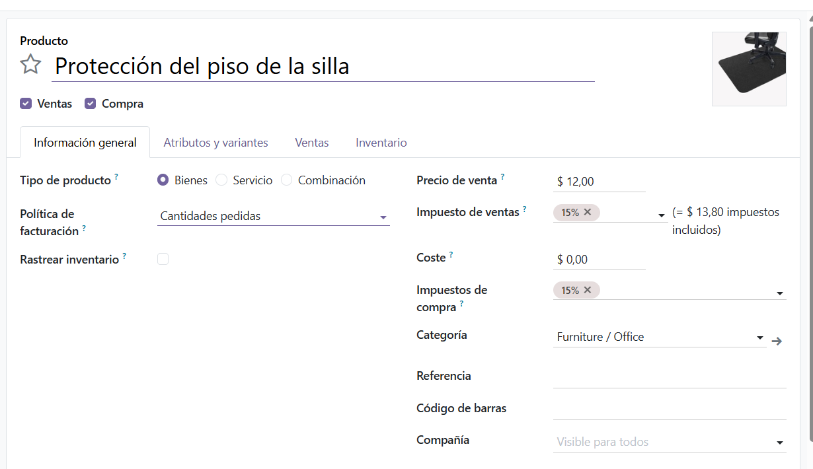

---

## 3. Ejercicio 2 · Recorrido Comercial (Del Cliente a la Factura Pagada)

A continuación se detalla la secuencia completa del flujo de ventas y facturación ejecutado dentro de la base de datos `demo`:

1. **Gestión de Contactos:** Creación de un nuevo contacto de tipo *Compañía* con NIF/CIF válido, dirección completa y etiqueta de categorización.
2. **Catálogo de Productos:** Alta de dos productos propios:
   * `Hora de soporte`: Tipo *Servicio*, PVP 40 €, IVA al 21%.
   * `Libro técnico`: Tipo *Bienes*, PVP 25 €, IVA al 4%.
3. **Presupuesto y Pedido de Venta:** Creación de un presupuesto para el cliente, simulación del envío por correo electrónico y confirmación para generar el pedido de venta (`S00...`).
4. **Facturación:** Generación de la factura desde el pedido de venta, comprobando el desglose de IVA (21% y 4%) y confirmación para su publicación.
5. **Cobro y Registro de Pago:** Registro del pago mediante diario de Caja/Banco hasta obtener el estado **Pagado**. Descarga del documento en PDF.
6. **Factura de Proveedor:** Localización e inspección de una factura de compras para comparar los campos de *Proveedor*, *Referencia de factura* y cuentas contables respecto a la de cliente.
7. **Gestión de Chatter:** Programación de una actividad de tipo *Llamada* vinculada al historial del cliente.

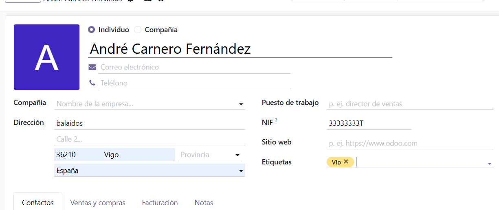
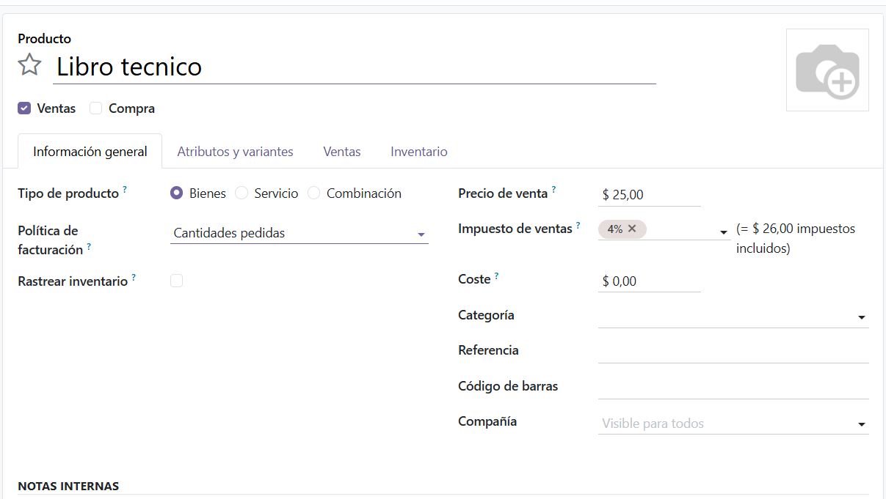
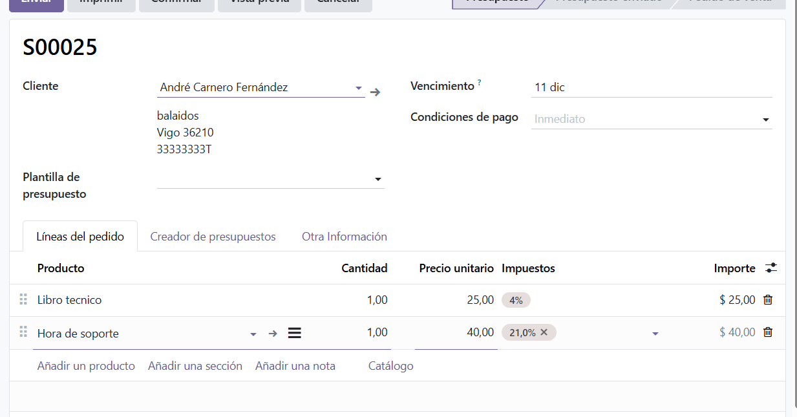
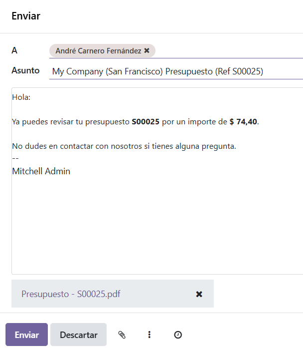
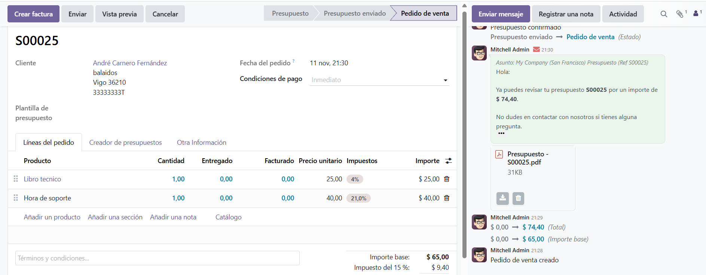
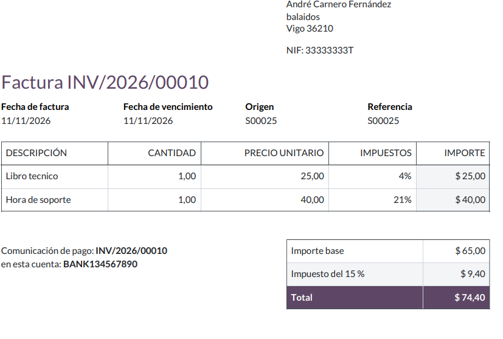
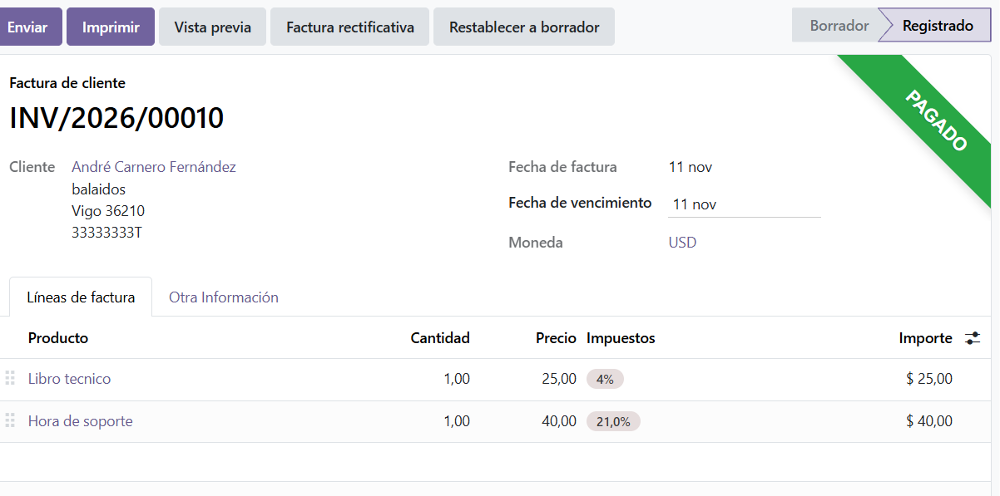
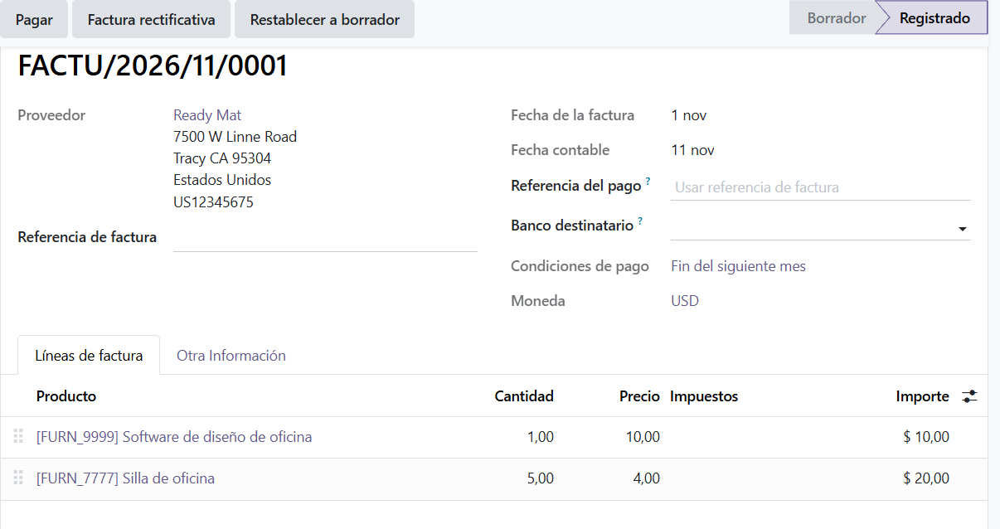
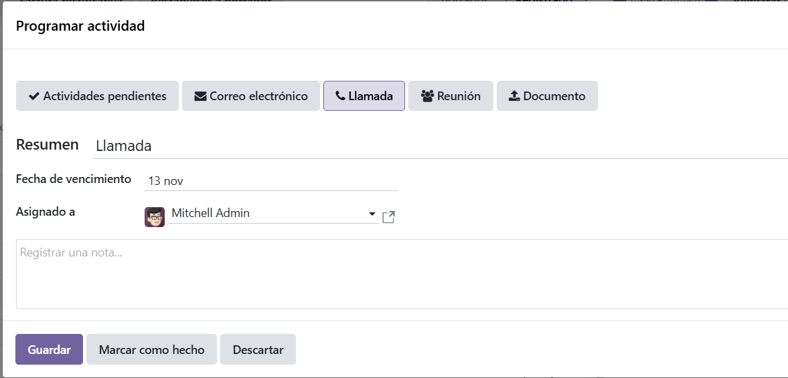

---

## 4. Ejercicio 3 · Búsqueda Guardada y Favoritos

En el módulo **Facturación ➔ Clientes ➔ Facturas**, se aplicó la siguiente vista y filtrado avanzado:
* **Vista:** Lista (tabla).
* **Filtro:** Facturas *Publicadas*.
* **Agrupación:** Por *Socio* (Cliente).
* **Favorito:** Búsqueda guardada bajo el nombre `Facturas publicadas por cliente`.

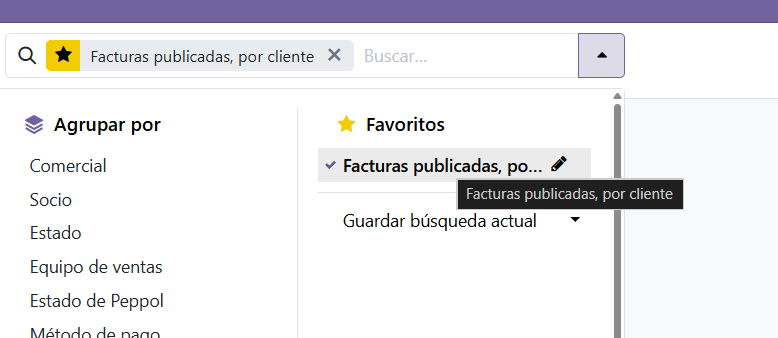
---

## 5. Ejercicio 4 · Modo Desarrollador y Nombres Técnicos

El modo desarrollador se activó mediante las dos vías disponibles en Odoo:
1. **Vía Interfaz:** *Ajustes ➔ Activar modo desarrollador*.
2. **Vía URL:** Añadiendo el parámetro `?debug=1` en la dirección del navegador.

### Tabla de Nombres Técnicos e Inspección de Campos

| Elemento en Interfaz | Nombre Técnico del Campo | Modelo de Odoo |
| :--- | :--- | :--- |
| **Nombre del Contacto** | `name` | `res.partner` |
| **NIF / CIF del Contacto** | `vat` | `res.partner` |
| **Facturas** | N/A (Modelo principal) | `account.move` |
| **Líneas de Factura** | `invoice_line_ids` | `account.move.line` |

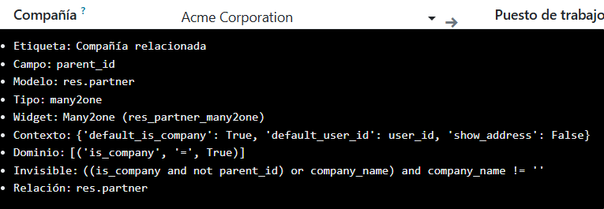
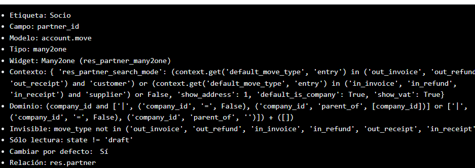

---

## 6. Registro de Incidencias Técnicas

Tabla de resolución de incidencias encontradas durante la configuración e interacción en la interfaz de Odoo 19:

| Síntoma / Error                                                              | Causa Raíz                                                                         | Solución Aplicada |
|------------------------------------------------------------------------------|:-----------------------------------------------------------------------------------| :--- |
| Bloqueo al activar la app de *Ventas* (el botón se queda en `Installing`).   | Exceso de tiempo de espera.                                                        | Forzado de recarga limpia de caché (`Ctrl + F5`) y reinicio del servicio de Odoo. |
| Error *"Ya se está haciendo otra acción"* al intentar instalar *Inventario*. | Bloqueo residual en el proceso interno de instalación de dependencias en Odoo.     | Eliminación y re-creación limpia de la base de datos `demo` desde el gestor. |

---

## 7. Declaración de Uso de Inteligencia Artificial

* **Uso realizado:** Asistencia en la resolución de incidencias como por ejemplo problemas con la instalacion de aplicaciones
* Utilizado para la creacion del readme, aunque ha sido supervisado previamente